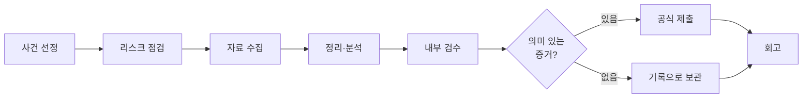

# 민간수사단 “찾는다” 운영 기획서

`v1` · `2026-11-05` · `초안` · 읽는 시간 본문 약 5분 (부록 포함 약 9분)

> “찾는다”는 시민이 합법적인 범위 안에서 사건을 들여다보고 사람과 진실을 찾기 위해 움직이는 소규모 동아리입니다.
> 공개 자료(OSINT)를 바탕으로 단서를 모아 검증하고, 의미 있는 증거가 나오면 공식 기관에 제보합니다.

| 한눈에 보기 | |
| --- | --- |
| **활동** | 공개 자료로 사건을 들여다보고, 의미 있는 증거가 나오면 공식 기관에 제보 |
| **팀** | 사건 1건을 4명이 한 팀으로 맡음 |
| **시간** | 주 3시간 |
| **방식** | 온라인 |

**본문** [1. 시작한 이유](#1-시작한-이유) · [2. 활동 방식과 운영 원칙](#2-활동-방식과-운영-원칙) · [3. 팀 구조](#3-팀-구조) · [4. 사건 진행 순서](#4-사건-진행-순서) · [5. 단계별 계획](#5-단계별-계획) · [6. 리스크와 대응](#6-리스크와-대응) · [7. 앞으로 정할 것](#7-앞으로-정할-것)

**부록** [A. OSINT란 무엇인가](#부록-a-osint란-무엇인가) · [B. 참고 사례와 볼 자료](#부록-b-참고-사례와-볼-자료) · [C. 국내 사례: 추적단 불꽃](#부록-c-국내-사례-추적단-불꽃n번방)

---

## 1. 시작한 이유

- **계기:** 실종아동의 현재 모습을 AI로 추정하는 프로젝트를 하다가 “우리가 진짜 찾아보자”는 생각이 들었습니다.
- **참고한 사례:** 넷플릭스 다큐 「고양이는 건드리지 마라」에서 평범한 시민들이 공개된 단서를 모아 범죄자를 추적하는 모습을 보고, 한국에서도 민간이 할 수 있는 일이 있기를 바랐습니다. 이 작품은 오인 추적과 과열의 위험도 함께 보여주므로 그 교훈을 운영 원칙에 반영합니다.
- **제도 환경:** 탐정 관련 법이 일부 정비됐지만 민간 조사의 범위와 한계를 정한 제도는 아직 미비합니다. 그래서 법이 허용하는 범위 안에서 작게 시작합니다.

---

## 2. 활동 방식과 운영 원칙

하는 일과 하지 않는 일을 목록으로 가르기보다, 지켜야 할 원칙과 사건마다 함께 판단하는 영역으로 나눕니다.

### 운영 원칙

> [!IMPORTANT]
> 원칙 1, 2는 모집 페이지에 공개한 약속이며 어떤 경우에도 바뀌지 않습니다. 나머지는 OSINT의 기본 방식(수집, 검증, 분석, 보고)을 따릅니다.

| 구분 | 원칙 | 내용 |
| :---: | --- | --- |
| **1** | **2차 피해 방지 우선** | 2차 피해 가능성이 높거나 실제 피해가 생기면 해당 수사를 즉시 중단한다 |
| **2** | **법적 윤리 준수** | 민간 자율 수사의 한계를 지키고, 불법적인 상황을 알게 되면 즉시 중단한다 |
| **3** | **공개 출처만 사용** | 누구나 합법적으로 접근할 수 있는 출처만 쓰고, 온라인에서 누구와도 접촉하지 않는 수동적 수집만 한다 |
| **4** | **출처 기록과 교차 검증** | 모든 자료에 출처와 접근일을 기록하고, 하나의 출처만으로 사실로 확정하지 않는다 |
| **5** | **사실과 추정 분리** | 확인된 사실, 출처, 추정, 의문점을 구분해서 쓴다 |
| **6** | **개인정보 최소화** | 사건 해결에 필요한 정보만 수집하고 보관한다 |
| **7** | **의미 있는 증거는 공식 경로로** | 의미 있는 증거가 나왔을 때 경찰 등 공식 기관에 제보하고, 외부에 공개하지 않는다 |
| **8** | **비밀유지** | 팀 내부 논의와 미공개 분석은 밖으로 내보내지 않는다 |

### 사건마다 함께 판단하는 영역

- 사람을 찾는 쪽으로 갈지, 사건을 들여다보는 쪽으로 갈지
- 어떤 단서가 의미 있고, 어디까지 파고들지
- 공개 자료를 어떻게 해석하고, 얼마나 확신할지(사실인지 추정인지)
- 사건 관련인의 정보를 어디까지 다룰지
- 언제, 무엇을 공식 기관에 건넬지

판단은 팀이 함께 하고, 애매하면 운영진에게 올려 승인을 받으며, 판단한 이유를 기록합니다. 정답을 미리 정해 두지 않고, 사건마다 쌓이는 판단이 이 동아리의 기준이 됩니다.

> [!NOTE]
> **공식 기관의 몫**
> 비공개 기록 조회, 신문과 수색, 신병 확보 같은 일은 공식 기관이 합니다. 우리는 단서를 공식 기관이 확인하기 쉬운 형태로 건넵니다.

---

## 3. 팀 구조

사건 1건을 4명이 한 팀으로 맡습니다.

| 역할 | 하는 일 |
| --- | --- |
| **팀장** | 일정 관리, 팀 내 조율, 중단이 필요해 보이면 운영진에게 즉시 보고 |
| **팀원** | 자료 수집, 타임라인 정리, 사실과 추정 구분, 개인정보·단정 표현 점검을 나눠 맡음 |

시범 단계에서는 팀장을 정하지 않고 역할을 돌아가며 맡아봅니다.

---

## 4. 사건 진행 순서

1. **사건 선정:** 경찰이나 공식 기관이 대중에게 제보를 요청하며 공개한 사건(예: 안전Dream의 실종 정보, 경찰의 공개수배 사건)을 고릅니다. 사건 유형은 제한하지 않되, 성착취물 같은 불법 촬영물이 수반되는 사건은 착수하지 않습니다. 공개 자료가 충분하고 법적 상태(수사 진행, 공소시효 등)가 확인되는 사건이어야 합니다.
2. **리스크 점검:** 2차 피해와 법적 위험을 체크리스트로 점검하고, 사건 관련인의 신원을 어디까지 다룰지 팀이 판단해 운영진이 착수를 승인합니다. 가족이나 경찰이 이미 공개한 정보를 우선하고, 특정 개인을 범인으로 지목하거나 외부에 공개하지는 않습니다.
3. **자료 수집:** 온라인에서 공개 자료를 모으고, 모든 자료에 출처와 접근일을 기록합니다.
4. **정리·분석:** 타임라인을 만들고 의문점을 도출하며, 사실과 추정을 구분합니다.
5. **내부 검수:** 개인정보, 단정 표현, 명예훼손 소지를 점검합니다.
6. **공식 제출(조건부):** 의미 있는 증거가 나왔을 때만 운영진 승인 후 공식 채널로 제출하고 이력을 남깁니다. 분석 중에도 그런 단서가 나오면 기다리지 않고 제보하며, 제보 후 처리 결과를 확인해 기록합니다. 의미 있는 증거가 나오지 않으면 제출하지 않고 기록으로 남깁니다. 무엇이 의미 있는 증거인지는 사건마다 팀이 판단합니다.
7. **회고:** 잘된 점과 문제를 기록해 다음 사건의 규칙에 반영합니다.

> [!WARNING]
> **즉시 중단 조건** — 어느 단계에서든 아래에 해당하면 멈춥니다.
>
> - 2차 피해 가능성이 높아지거나 실제 피해가 생긴 경우
> - 불법적인 수단이나 정보가 개입된 경우
> - 특정 개인을 범인으로 단정하는 쪽으로 논의가 흐르는 경우
> - 유가족이나 관련자가 중단을 요청한 경우
>
> 중단은 누구나 요청할 수 있고, 팀장은 운영진에게 즉시 보고합니다.

---

## 5. 단계별 계획

처음부터 여러 팀을 운영하지 않고, 1팀이 먼저 해본 뒤 그 경험으로 팀을 나눕니다.

| 단계 | 구성 | 내용 |
| :---: | --- | --- |
| **1. 시범 운영** | 4명, 1팀 (1개월) | 규칙과 절차를 함께 다듬고 호흡을 맞춥니다. |
| **2. 팀 분화** | 시범 참여자가 팀장이 되어 3팀 (신규 9명) | 팀장이 줄거나 인원이 부족하면 신규 6명으로 2팀을 꾸립니다. |
| **3. 반복 확장** | 같은 방식으로 팀 추가 | 새 팀의 팀장은 사건을 한 번 이상 끝낸 사람 중에서 나옵니다. |

**팀 분화 조건**

- 운영 규칙, 윤리 서약, 중단 프로토콜이 확정됐다.
- 연습 보고서가 내부 검수를 통과했다.
- 팀장을 맡을 사람이 최소 2명 있다.
- 법률 확인 경로가 마련됐다.

### 시범 1개월

주 3시간 기준으로 4주간 진행합니다. 호흡을 맞추는 단계이므로 제출용이 아닌 **연습 사건**으로 진행하고, 4주차 평가에서 수준이 충분하면 같은 사건을 이어갈지 정합니다.

| 주차 | 활동 |
| :---: | --- |
| **1주차** | 원칙과 서약을 함께 읽고 역할을 정하며, 종결됐고 자료가 풍부한 연습 사건을 고릅니다. |
| **2주차** | 같은 사건의 자료를 각자 모아 비교하며 출처 기록 방식을 맞춥니다. |
| **3주차** | 타임라인을 만들고 사실과 추정을 구분하는 연습을 합니다. |
| **4주차** | 서로 검수하고 회고하며, 규칙을 확정하고 팀장을 맡을 의향을 확인합니다. |

시간이 모자라면 1~2주 연장합니다.

---

## 6. 리스크와 대응

| 리스크 | 영향 | 대응 |
| --- | :---: | --- |
| 피해자·유가족 등에 대한 2차 피해 | 높음 | 착수 전 리스크 점검, 즉시 중단 규칙, 결과를 외부에 공개하지 않음 |
| 법 위반(개인정보, 명예훼손, 스토킹 등) | 높음 | 공개 자료만 사용, 내부 검수, 법률 확인 경로 확보 |
| 집단 사고와 범인 단정(과열) | 높음 | 사실과 추정 분리, 단정 표현 금지, 반대 의견을 맡는 역할 지정 |
| 초기 운영 경험 부족 | 높음 | 외부 자문 확보, 착수·제출 승인 절차 유지, 작은 사건부터 |
| 명칭 오해 | 중간 | 경찰과의 공식 관계는 아직 없으므로 협력은 향후 목표로 표기 |
| 멤버 이탈과 신원 노출 | 중간 | 조 최소 인원과 예비 인원, 활동명 사용, 수집 정보 최소화 |

---

## 7. 앞으로 정할 것

아래 항목은 인원이 모이면 함께 정합니다.

1. **활동 시간 운영:** 주 3시간을 회의와 개별 활동으로 어떻게 나눌지, 회의를 둘지
2. **자료 보관:** 수집 자료와 보고서를 어디에 어떤 방식으로 보관하고, 누가 접근하며, 언제 폐기할지
3. **사건 범위별 착수 기준:** 유형은 제한하지 않되, 유형별 위험도에 따라 착수 승인 기준을 다르게 둘지
4. **멤버 선발과 활동명:** 선발 방식, 활동명 사용 방식
5. **운영 형태:** 인원이 늘면 단체 등록이 필요한지
6. **자문:** 법률·수사 경험이 있는 자문을 어떻게 구할지

---

## 부록 A. OSINT란 무엇인가

**OSINT**는 Open Source Intelligence의 약자로, 한국어로는 **공개출처정보**입니다. 소프트웨어의 오픈소스가 아니라, 누구나 합법적으로 접근할 수 있는 출처에서 정보를 모으고 검증·분석해 보고하는 일을 말합니다.

| 수집 | 검증 | 분석 | 보고 |
| :---: | :---: | :---: | :---: |
| 공개 출처에서 자료를 모은다 | 여러 출처로 교차 확인한다 | 타임라인과 의문점을 정리한다 | 사실과 추정을 구분해 전달한다 |

**공개 출처의 예:** 언론 보도와 방송, 열람이 허용된 법원 판결서, 공공 데이터와 정부 공개 정보(안전Dream 등), 지도·위성사진·로드뷰, 공개로 설정된 SNS 게시물, 사진·영상 속 단서(촬영 장소와 시간 추정).

> [!CAUTION]
> 접근할 수 있다는 것과 마음대로 이용해도 된다는 것은 다릅니다. 공개된 자료도 저작권과 개인정보 보호의 대상이 될 수 있습니다. 공개된 정보는 불완전하고 틀릴 수 있으며, 사람의 신원을 특정하는 쪽으로 쓰면 오인의 위험이 큽니다.

[2장](#2-활동-방식과-운영-원칙)의 원칙 3~6은 OSINT의 기본 방식에 해당하고, 원칙 1·2·7·8은 사람을 보호하는 장치입니다.

---

## 부록 B. 참고 사례와 볼 자료

### 따라 할 모델: Trace Labs

캐나다에서 시작한 비영리 단체로, 자원봉사자들이 실종자 사건의 공개 정보를 모아 경찰에 전달합니다.

| 항목 | Trace Labs | “찾는다”에 주는 시사점 |
| --- | --- | --- |
| 팀 규모 | 최대 4명이 한 팀 | 4인 1조 구조의 근거 |
| 활동 방식 | 수동적 수집만 하고 누구와도 직접 접촉하지 않음 | 원칙 3과 같은 방향 |
| 사건 선정 | 경찰이 대중의 도움을 요청한 사건만 다룸 | [4장](#4-사건-진행-순서) 사건 선정 기준에 반영 |
| 결과 전달 | 추측을 하지 않고 수집한 정보만 경찰에 전달 | 원칙 5, 7과 같은 방향 |

### 반면교사

- **「고양이는 건드리지 마라」(Netflix):** 시민 추적단이 처음에는 용의자를 엉뚱한 사람으로 오인했습니다.
- **「Crime Scene: The Vanishing at the Cecil Hotel」(Netflix, 2021):** 웹 슬루스들이 근거 없이 음악가 Morbid(Pablo Vergara)를 범인으로 몰아 괴롭혔습니다. 3, 4화가 특히 참고가 됩니다.

### 볼 영상·자료 (추천 순서)

1. [Freethink, “Hackers find missing people for fun”](https://www.freethink.com/technology/online-hackers-hunt-down-missing-people): Trace Labs를 가장 쉽게 보여주는 영상과 기사
2. [Trace Labs 교육 재생목록(YouTube)](https://www.youtube.com/playlist?list=PLlaJQR699XLt4ib7yWgvaWM7KA12uTlB9): 공식 교육 영상
3. [DeepSec 2019, “Techniques and Tools for Becoming an Intelligence Operator”](https://infocondb.org/con/deepsec/deepsec-2019-internet-of-facts-and-fears/techniques-and-tools-for-becoming-an-intelligence-operator): 창립자 Robert Sell의 강연
4. [EENA 2021 기조연설 슬라이드](https://fr.slideshare.net/EENA-112/eena-2021-keynote-opensource-intelligence-osint-for-emergency-services-missing-people): 실제 사건 예시
5. [Trace Labs OSINT Field Manual](https://github.com/tracelabs/tofm/blob/main/tofm.md): 실종자 OSINT 입문 매뉴얼(영어)
6. Netflix 「Crime Scene: The Vanishing at the Cecil Hotel」과 「고양이는 건드리지 마라」: 잘못된 추적이 어떤 피해를 내는지
7. [SBS 《그것이 알고 싶다》 1343회(2023.03.11)](https://programs.sbs.co.kr/programTemplate/amp/vod/unansweredquestions/22000492164)와 영화 《증발》(2020): 한국 사례

---

## 부록 C. 국내 사례: 추적단 불꽃(N번방)

불꽃은 익명의 대학생 2명으로 이루어진 추적단입니다. 한겨레가 N번방 사건을 처음 연속 보도했고, 국민일보는 불꽃과 함께 6개월간 잠입 취재한 기록을 연재했습니다. 이 활동은 한국기자협회의 이달의 기자상 특별상을 받았습니다. 불꽃의 활동은 시민 단독 활동이 아니라 언론사 취재의 틀 안에서 경찰 수사와 이어진 활동이었다는 점이 중요합니다.

| 재현할 수 있는 것 | 그대로 따라 하면 안 되는 것 |
| --- | --- |
| **꼼꼼한 기록과 끈기:** 처음에는 반향이 크지 않았지만 보도가 이어지며 사회가 움직였습니다. | **잠입:** 언론사와 함께하는 취재였고 위험이 매우 컸습니다. 일반 동아리가 따라 하면 법적·신변 위험이 큽니다. |
| **협업:** 기자, 경찰과 연결돼 있었습니다. | **성착취물과의 접촉:** 아동·청소년 성착취물은 소지·시청만으로도 처벌 대상입니다. 이런 자료가 수반되는 사건은 착수하지 않고, 발견하면 즉시 중단하고 신고합니다. |
| **익명 활동과 피해자 보호:** 활동명 사용은 신변 보호에 필수이고, 피해자 신상을 노출하는 보도가 또 다른 가해가 된다는 지적은 원칙 1의 근거입니다. | **정신적 부담:** 한겨레 오연서 기자는 N번방 취재 내내 죄책감과 무력감에 시달렸다고 밝혔습니다. 유해한 자료를 다루는 사건은 제외하고, 멤버가 쉴 수 있는 규칙과 상담 연결을 마련해야 합니다. |

### 볼 자료

- Netflix 「사이버 지옥: N번방을 무너뜨려라」(2022): 사이버 수사대, 기자, PD, 경찰 등 24인의 인터뷰로 사건을 추적한 다큐멘터리입니다. 성범죄를 다루므로 시청 수위에 주의하세요.
- [한국기자협회, “‘n번방’ 피의자 검거, 그 뒤엔 기자들의 집념이 있었다”](https://www.journalist.or.kr/m/m_article.html?no=47444)
- [한국기자협회, “추적단 불꽃 기자상 특별상”](https://www.journalist.or.kr/m/m_article.html?no=47581)
- [에스콰이어, “나는 텔레그램 N번방에 있었다”](https://www.esquirekorea.co.kr/article/46039): 한겨레 오연서 기자의 취재 후기

---

## 변경 이력

| 버전 | 날짜 | 변경 내용 |
| :---: | --- | --- |
| v1 | 2026-11-05 | 최초 작성 |
